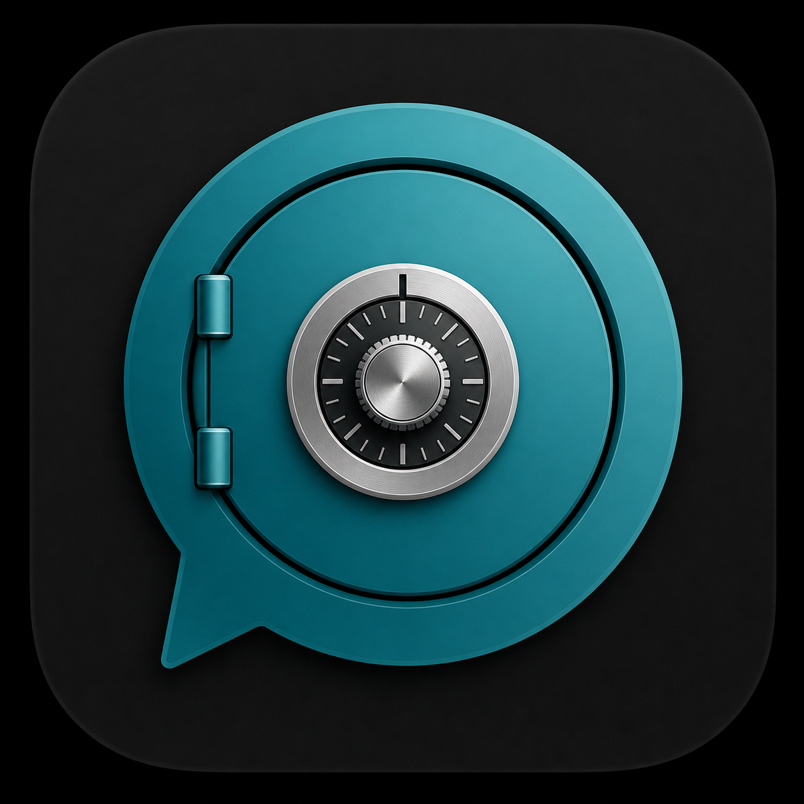
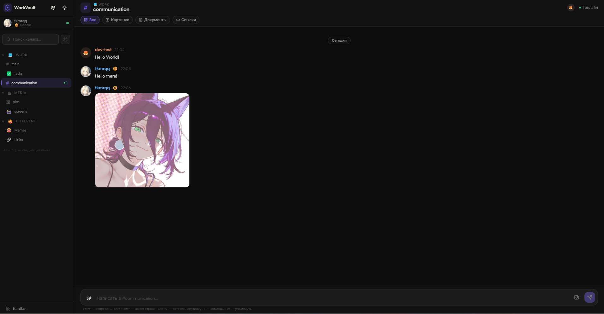
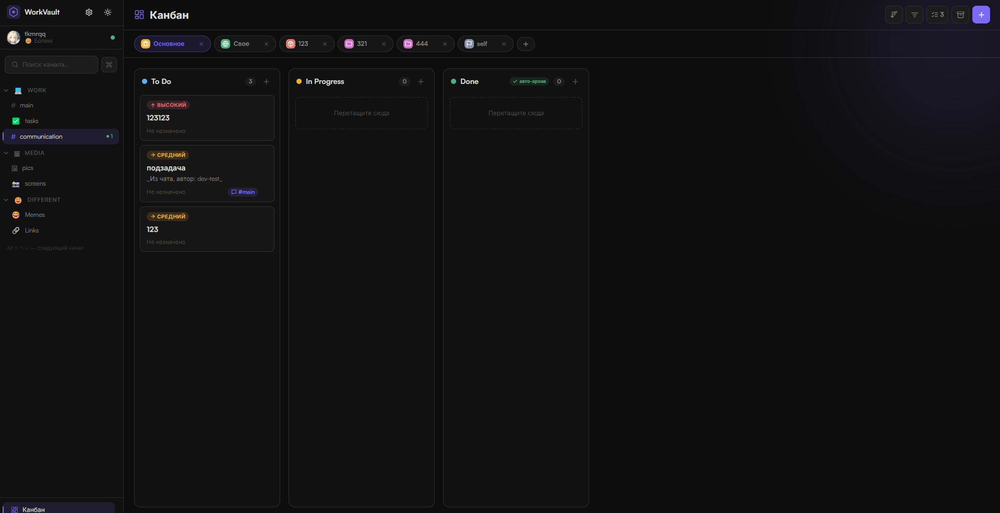
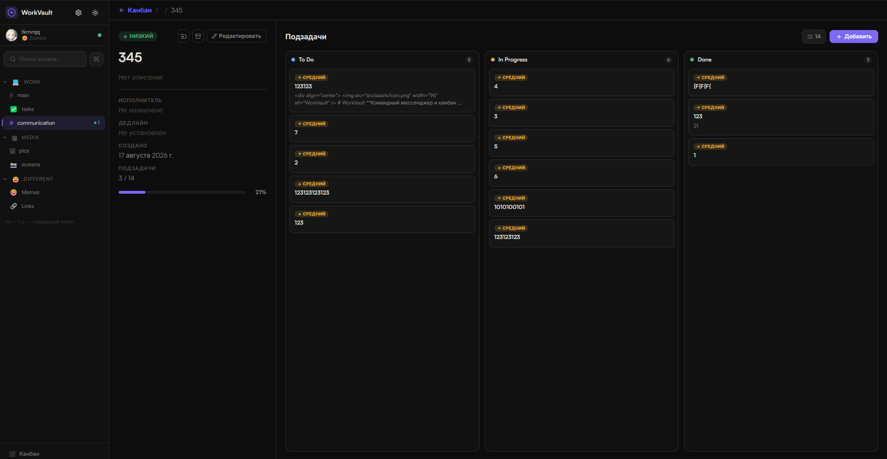
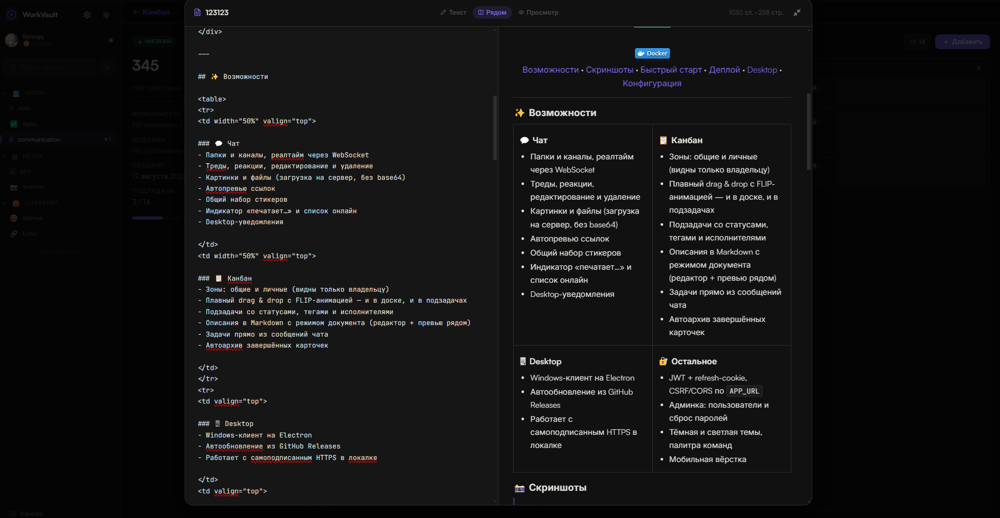

<div align="center">



# WorkVault

**Командный мессенджер и канбан в одном окне.**<br/>
Как «Избранное» в Telegram, только для всей команды — с каналами, задачами и подзадачами.

[](https://github.com/tkmrqq/workvault/actions/workflows/deploy.yml)
[](https://github.com/tkmrqq/workvault/actions/workflows/desktop.yml)
[](https://github.com/tkmrqq/workvault/releases/latest)


[Возможности](#-возможности) · [Скриншоты](#-скриншоты) · [Быстрый старт](#-быстрый-старт) · [Деплой](#-деплой) · [Desktop](#-desktop-клиент) · [Конфигурация](#%EF%B8%8F-конфигурация)

</div>

---

## ✨ Возможности

<table>
<tr>
<td width="50%" valign="top">

### 💬 Чат
- Папки и каналы, реалтайм через WebSocket
- Треды, реакции, редактирование и удаление
- Картинки и файлы (загрузка на сервер, без base64)
- Автопревью ссылок
- Общий набор стикеров
- Индикатор «печатает…» и список онлайн
- Desktop-уведомления

</td>
<td width="50%" valign="top">

### 📋 Канбан
- Зоны: общие и личные (видны только владельцу)
- Плавный drag & drop с FLIP-анимацией — и в доске, и в подзадачах
- Подзадачи со статусами, тегами и исполнителями
- Описания в Markdown с режимом документа (редактор + превью рядом)
- Задачи прямо из сообщений чата
- Автоархив завершённых карточек

</td>
</tr>
<tr>
<td valign="top">

### 🖥 Desktop
- Windows-клиент на Electron
- Автообновление из GitHub Releases
- Работает с самоподписанным HTTPS в локалке

</td>
<td valign="top">

### 🔐 Остальное
- JWT + refresh-cookie, CSRF/CORS по `APP_URL`
- Админка: пользователи и сброс паролей
- Тёмная и светлая темы, палитра команд
- Мобильная вёрстка

</td>
</tr>
</table>

## 📸 Скриншоты

<table>
<tr>
<td></td>
<td></td>
</tr>
<tr>
<td align="center"><sub>Каналы и треды</sub></td>
<td align="center"><sub>Канбан-доска</sub></td>
</tr>
<tr>
<td></td>
<td></td>
</tr>
<tr>
<td align="center"><sub>Карточка и подзадачи</sub></td>
<td align="center"><sub>Описание в режиме документа</sub></td>
</tr>
</table>

## 🧱 Стек

| Слой | Технологии |
|---|---|
| Фронтенд | Vue 3, Vite, Pinia, Vue Router, lucide-icons, marked + DOMPurify |
| Бэкенд | Node.js, Express, Socket.IO |
| База | SQLite (`better-sqlite3`), файл `data/workvault.db` |
| Desktop | Electron + electron-builder (NSIS, автообновление) |
| Инфраструктура | Docker, nginx (HTTPS), GitHub Actions, GHCR, Tailscale |

## 🗺 Архитектура

```text
           ┌──────────────┐        ┌──────────────┐
 Браузер ──┤              │        │              │
           │ nginx :443   ├───────►│ workvault    │──► data/workvault.db
 Electron ─┤ (TLS, static │  :3000 │ Express +    │──► data/uploads/
           │  uploads)    │        │ Socket.IO    │
           └──────────────┘        └──────────────┘
```

SPA и API отдаются с одного origin, поэтому в браузере `VITE_API_URL` не нужен. Electron берёт адрес сервера из `server-url.json`, который CI собирает вместе с клиентом.

<details>
<summary><b>Структура проекта</b></summary>

```text
workvault/
├── .github/workflows/   # deploy.yml (Docker → сервер), desktop.yml (Windows-клиент)
├── electron/            # main.js, preload.js
├── server/
│   ├── server.js        # Express + Socket.IO
│   ├── db.js            # схема SQLite и миграции
│   ├── auth.js          # JWT, cookies
│   ├── config.js        # чтение .env
│   └── admin/           # админка
├── src/
│   ├── views/           # ChatView, KanbanView, KanbanCardView, LoginView
│   ├── components/      # Sidebar, MessageList, MarkdownEditor, ThreadPanel…
│   ├── composables/     # useKanbanDrag, useMarkdown, useUiPreferences…
│   ├── lib/apiBase.js   # откуда фронт ходит в API
│   └── assets/base.css  # дизайн-токены
├── nginx/conf.d/        # конфиг nginx
├── scripts/deploy.sh    # выкатка на сервере
├── docker-compose.yml
└── dockerfile
```

</details>

## 🚀 Быстрый старт

Нужен **Node.js 20+**.

```bash
git clone https://github.com/tkmrqq/workvault.git
cd workvault
npm install
cp .env.example .env      # и поменяй JWT_SECRET / ADMIN_PASSWORD
```

| Команда | Что делает |
|---|---|
| `npm run start` | бэкенд + Vite + Electron вместе |
| `npm run server` | только бэкенд → http://localhost:3000 |
| `npm run dev` | только фронт → http://localhost:5173 (`/api` проксируется на :3000) |
| `npm run electron:dev` | Vite + Electron |
| `npm run build` | сборка SPA в `dist/` |
| `npm run build:electron` | сборка Windows-клиента локально, без публикации |

> [!TIP]
> Первого админа назначают через `POST /api/auth/bootstrap-admin` с ключом из `ADMIN_PASSWORD`. Это одноразовый мастер-ключ, а не пароль от аккаунта.

## 📦 Деплой

Деплой полностью автоматический:

```text
push в main ──► GitHub Actions ──► Docker-образ в ghcr.io/tkmrqq/workvault
                                         │
                                         ▼
                       Tailscale → SSH → scripts/deploy.sh
                       (docker compose pull && up, health-check)
```

- Ветка **`dev`** ничего не запускает, в ней можно копить изменения.
- **`main`** — прод: каждый push собирает и выкатывает сервер.
- Ручной запуск: *Actions → WorkVault Deploy → Run workflow*.

<details>
<summary><b>Секреты репозитория</b></summary>

| Секрет | Зачем |
|---|---|
| `APP_PUBLIC_URL` | публичный адрес, например `https://172.16.99.37` |
| `DEPLOY_HOST`, `DEPLOY_USER`, `DEPLOY_SSH_KEY` | SSH до сервера |
| `TS_OAUTH_CLIENT_ID`, `TS_OAUTH_SECRET` | вход CI в Tailscale |
| `JWT_SECRET`, `ADMIN_PASSWORD` | пишутся в `.env` на сервере |

</details>

<details>
<summary><b>Вручную, без CI</b></summary>

```bash
# на сервере, рядом с docker-compose.yml и .env
docker compose pull
docker compose up -d
curl -fsS http://127.0.0.1:3000/health
```

Сертификаты nginx лежат в `nginx/certs/`.

</details>

## 🖥 Desktop-клиент

Клиент собирается по тегу:

```bash
npm version patch        # 1.7.2 → 1.7.3, создаёт коммит и тег v1.7.3
git push origin main --follow-tags
```

Workflow **Desktop** собирает установщик и публикует его в Releases. Установленные клиенты подтянут обновление сами.

> [!NOTE]
> Сервер в локалке работает на самоподписанном сертификате. Клиент доверяет ему **только для хоста из `APP_PUBLIC_URL`**, остальные сайты проверяются как обычно.

## ⚙️ Конфигурация

Полный список с комментариями — в [`.env.example`](.env.example).

| Переменная | По умолчанию | Описание |
|---|---|---|
| `PORT` / `HOST` | `3000` / `0.0.0.0` | где слушает бэкенд |
| `APP_URL` | `http://localhost:3000` | публичный адрес; участвует в CORS/CSRF и должен совпадать с адресом в браузере |
| `CORS_ORIGINS` | — | дополнительные origin через запятую (`https://workvault.local`) |
| `CORS_ALLOW_ELECTRON` | `true` | пускать Electron (`Origin: null`) |
| `JWT_SECRET` | — | **обязателен**, свой на каждом окружении |
| `JWT_ACCESS_EXPIRES_IN` / `JWT_REFRESH_EXPIRES_IN` | `15m` / `30d` | время жизни токенов |
| `COOKIE_SECURE` | `false` | `true` за HTTPS |
| `ALLOW_REGISTRATION` | `true` | для закрытой команды лучше `false` |
| `ALLOW_LEGACY_PASSWORD_SETUP` | `false` | старый «задай пароль сам», не включать |
| `PUBLIC_USER_LIST` | `true` | список имён на экране входа |
| `UPLOADS_DIR` / `MAX_FILE_MB` | `./data/uploads` / `100` | файлы |
| `KANBAN_ARCHIVE_AFTER_DAYS` | `3` | через сколько дней «готово» уходит в архив |
| `VITE_API_URL` | — | только для сборки Electron (CI задаёт сам) |

## 🔒 Безопасность

Разбор и принятые меры — в [`SECURITY_REVIEW.md`](SECURITY_REVIEW.md), список изменений — в [`CHANGES.md`](CHANGES.md).

Если нашёл уязвимость, напиши мейнтейнерам лично, а не в публичный issue.

---

<div align="center"><sub>Сделано командой WorkVault</sub></div>
